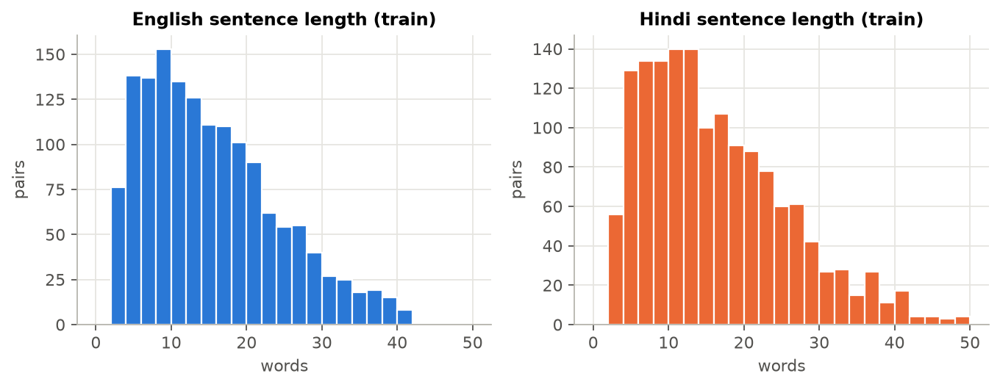
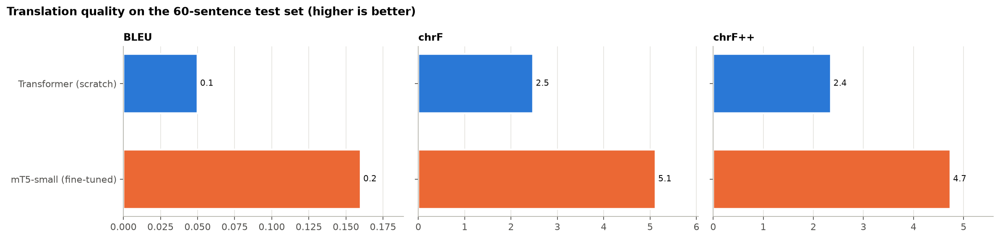
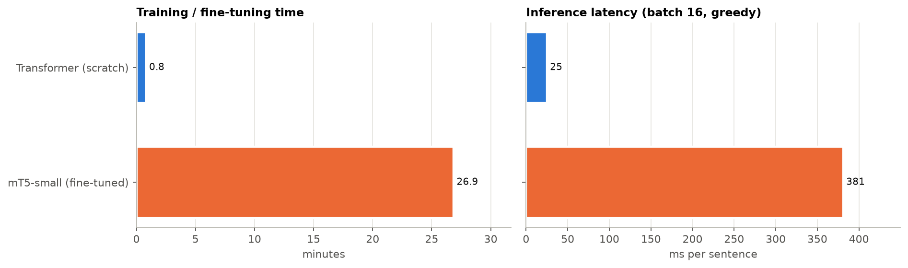
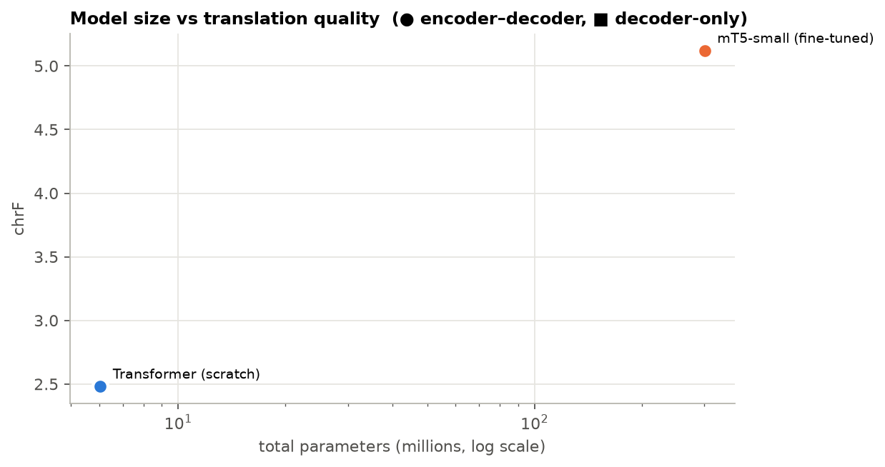
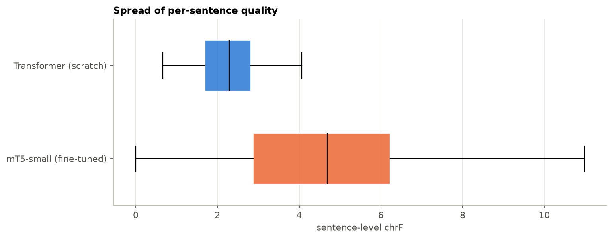
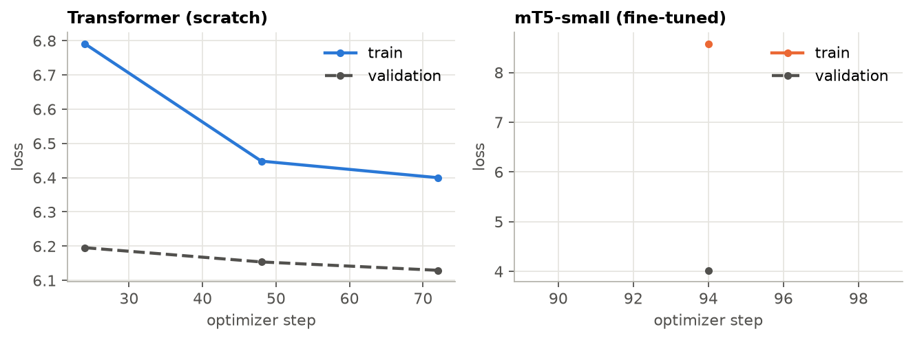
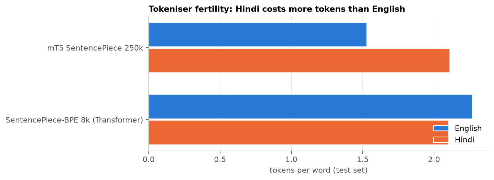
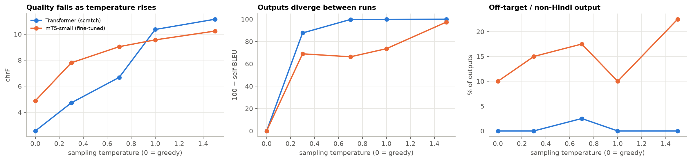

# English → Hindi Neural Machine Translation
### Comparing encoder–decoder (Transformer, mT5) and decoder-only (LLaMA, Gemma) models

**Foundations of Generative AI (ICT4403), Assignment 3**
Syed Ayaan Shere · Reg. No. 230911015 · B.Tech IT, Section A · Manipal Institute of Technology, MAHE

> Tables and charts marked *auto* are written by the notebook from its own results (`results/readme_sections/*.md`, then `fill_readme.py`). Every number in this README comes from an actual run.

---

## Contents
1. [Problem statement and objective](#1-problem-statement-and-objective)
2. [Dataset](#2-dataset)
3. [Models implemented](#3-models-implemented)
4. [Repository structure](#4-repository-structure)
5. [Execution steps and dependencies](#5-execution-steps-and-dependencies)
6. [Results](#6-results)
7. [Model comparison and evaluation](#7-model-comparison-and-evaluation)
8. [Sampling-temperature analysis](#8-sampling-temperature-analysis)
9. [Responsible and ethical AI](#9-responsible-and-ethical-ai)
10. [Sample translations](#10-sample-translations)
11. [Conclusion](#11-conclusion)
12. [References](#12-references)

---

## 1. Problem statement and objective

**Problem.** Translating English into Hindi is hard for neural models. Hindi uses a different script (Devanagari) and a different word order (SOV, where English is SVO). Its morphology is rich, and verbs and adjectives agree with the grammatical gender of the subject. English often leaves gender unstated, so an English→Hindi system is forced to make choices the source never made.

**Objective.** Build four translation systems on the **same** English–Hindi data and compare them under comparable settings:

| Family | Model | Architecture |
|---|---|---|
| Classic | Basic Transformer, trained from scratch | Encoder–decoder |
| Pretrained seq2seq | mT5-small, fully fine-tuned | Encoder–decoder |
| LLM | Llama-3.2-1B-Instruct, with 3-shot prompting and LoRA fine-tuning | Decoder-only |
| LLM | Gemma-3-1B-it, with 3-shot prompting and LoRA fine-tuning | Decoder-only |

Each system is evaluated on **BLEU, chrF, training time, inference time and parameter count**. The study also covers **sampling temperature** and **responsible-AI risks** (bias, hallucination, cultural misrepresentation, sensitive content), each with mitigation measures.

---

## 2. Dataset

**IIT Bombay English–Hindi Parallel Corpus**: [https://huggingface.co/datasets/cfilt/iitb-english-hindi](https://huggingface.co/datasets/cfilt/iitb-english-hindi)
(original release: [CFILT, IIT Bombay](https://www.cfilt.iitb.ac.in/iitb_parallel/); Kunchukuttan, Mehta & Bhattacharyya, LREC 2018; licence CC BY-NC 4.0)

* About **1.66 M** training pairs, plus a 520-pair dev set and a 2,507-pair test set (news domain, WMT 2014).
* The training data mixes many sources: government and legal text, Wikipedia, TED talks, Gyaan-Nidhi books, judicial text, and a large share of short software-localisation strings (GNOME, KDE).

**Preprocessing** (Section 2 of the notebook):
1. Unicode NFC normalisation, removal of zero-width characters, whitespace clean-up.
2. Keep pairs with 3–40 English words and 3–50 Hindi words. The 3-word minimum removes most UI strings such as "Open File".
3. Remove software artefacts: `%s`, `{0}`, HTML tags, URLs, accelerator underscores.
4. Script checks: the Hindi side must be ≥ 70 % Devanagari and the English side must contain no Devanagari.
5. Hindi/English word-length ratio between 0.5 and 2.5, to drop misaligned pairs.
6. De-duplicate on the source sentence, so no test sentence also appears in training.
7. Shuffle with a fixed seed (42) and split into **train 20,000 / validation 500 / test 500**. The assignment allows a manageable subset. Every model sees exactly these splits.

<!-- AUTO:dataset -->
_Run the notebook to fill this section._
<!-- /AUTO:dataset -->



---

## 3. Models implemented

| | Basic Transformer | mT5-small | Llama-3.2-1B-Instruct | Gemma-3-1B-it |
|---|---|---|---|---|
| Architecture | Encoder–decoder | Encoder–decoder | Decoder-only | Decoder-only |
| Size | ~7.6 M (3+3 layers, d=256) | ~300 M (8+8 layers, d=512) | ~1.2 B (16 layers) | ~1.0 B (26 layers) |
| Pretraining | none | mC4, 101 languages, span corruption (no parallel data) | ~9 T tokens, instruction-tuned; Hindi officially supported | instruction-tuned; **1B variant officially English-only** |
| Tokeniser | own SentencePiece BPE, 8k, trained on our 20k pairs | SentencePiece, 250k | BPE, 128k | SentencePiece, 262k |
| Adaptation | trained from scratch | full fine-tuning (all weights) | (a) 3-shot prompting; (b) LoRA r=16 on all projections | (a) 3-shot prompting; (b) LoRA r=16 on all projections |
| Training data | 20k pairs, early stopping | 20k pairs, 4 epochs | 5k pairs, 1 epoch (LoRA) | 5k pairs, 1 epoch (LoRA) |
| Precision (T4) | fp16 mixed | fp32 (mT5 overflows in fp16) | fp16 | fp32 (Gemma 3 overflows in fp16) |

**Shared settings for a fair comparison:** the same test set; greedy decoding; inference batch size 16; at most 200 new tokens; length-sorted batches; the same sacreBLEU metrics and text normalisation; the same prompt text for both LLMs; the same LoRA settings and an effective batch of 16 for both LLMs.

* **Basic Transformer.** Built with `nn.Transformer`: sinusoidal positional encodings, pre-LayerNorm, embeddings shared between encoder, decoder and output layer, label smoothing 0.1, AdamW with β=(0.9, 0.98), warm-up then cosine decay, early stopping on validation loss. A batched greedy/sampling decoder is written by hand.
* **mT5-small.** `google/mt5-small` with the task prefix `translate English to Hindi:`. Seq2seq cross-entropy, AdamW at 5e-4, the best checkpoint chosen by validation loss.
* **LLaMA / Gemma, prompting.** Each model's own chat template, an instruction ("Translate … reply with only the Hindi translation"), and three fixed training pairs as earlier user/assistant turns. Output cleaning keeps the first Devanagari line and strips labels like "Hindi:". The raw outputs are saved too, so extra chatter shows up in the analysis.
* **LLaMA / Gemma, LoRA.** PEFT LoRA (r=16, α=32, dropout 0.05) on `q,k,v,o,gate,up,down`. Loss is computed **only on the Hindi answer tokens**. Gradient checkpointing is on. The adapter is merged into the base weights before inference.

---

## 4. Repository structure

```
fgai-a3-en-hi-translation/
├── FGAI_A3_EnHi_Translation.ipynb   # complete pipeline (run on Colab T4)
├── README.md                        # this report
├── requirements.txt
├── fill_readme.py                   # writes results/readme_sections/*.md into this README
├── data/                            # train/val/test splits (TSV) + few-shot examples
├── results/
│   ├── metrics.csv / metrics.json   # BLEU, chrF, chrF++, params, train/inference time, memory
│   ├── quality_checks.csv           # hallucination / off-target / number-consistency checks
│   ├── tokenizer_fertility.csv
│   ├── temperature_sweep.csv
│   ├── gender_probe_summary.csv, ethics_probe_outputs.csv
│   ├── training_logs/*.csv, train_meta/*.json
│   └── readme_sections/*.md         # auto-generated tables used in this README
├── plots/                           # every chart referenced below
└── samples/
    ├── predictions/*.csv            # every test translation, per model (clean + raw)
    ├── test_translations_all_models.csv
    ├── sample_translations.md
    ├── temperature_samples.md
    └── ethics_probe_outputs.md
```
Model weights (`models/`) are not committed because of their size.

---

## 5. Execution steps and dependencies

**Dependencies** (`requirements.txt`): Python ≥ 3.10, PyTorch ≥ 2.1, transformers ≥ 4.56, peft ≥ 0.13, accelerate, datasets, sentencepiece, sacrebleu ≥ 2.4, pandas, matplotlib, protobuf.

**Hardware:** one NVIDIA T4 (16 GB), as on free Google Colab. A full run takes about 2–2.5 h.

**Steps**
1. On Hugging Face, accept the licences for [meta-llama/Llama-3.2-1B-Instruct](https://huggingface.co/meta-llama/Llama-3.2-1B-Instruct) and [google/gemma-3-1b-it](https://huggingface.co/google/gemma-3-1b-it), then create a *read* access token.
2. Open `FGAI_A3_EnHi_Translation.ipynb` in Google Colab and choose *Runtime → Change runtime type → T4 GPU*.
3. Add the token as a Colab secret named **`HF_TOKEN`** (key icon in the sidebar) and allow notebook access.
4. Choose *Runtime → Run all*. Outputs are written to `MyDrive/fgai-a3-en-hi-translation/`. If the session disconnects, run all again and finished stages are loaded from Drive.
   * `QUICK_RUN = True` in the config cell gives a 10–15 minute dry run.
   * `RUN = dict(...)` switches individual models on or off.
5. The last cell downloads `fgai_a3_outputs.zip` (results, plots, samples, data). Unzip it into this repository and save the executed notebook here with its outputs (*File → Download → .ipynb*).
6. Run `python fill_readme.py` to write the auto-generated tables into this README, then commit and push.

Running locally works the same way: `pip install -r requirements.txt`, set `HF_TOKEN`, then `jupyter notebook`. With `USE_DRIVE` ignored outside Colab, outputs are written next to the notebook.

---

## 6. Results

Test set: 500 held-out sentence pairs. All systems use greedy decoding. BLEU, chrF and chrF++ come from sacreBLEU, with Devanagari punctuation (।) separated before scoring. *Inference time* covers the whole test set at batch size 16 on a T4, including tokenisation. *Train time* is wall-clock time for training or fine-tuning; prompting needs none.

<!-- AUTO:metrics -->
_Run the notebook to fill this section._
<!-- /AUTO:metrics -->







---

## 7. Model comparison and evaluation

### 7.1 Key findings (auto)
<!-- AUTO:findings -->
_Run the notebook to fill this section._
<!-- /AUTO:findings -->

### 7.2 Why the architectures behave differently

**Encoder–decoder (Transformer, mT5).** A bidirectional encoder reads the whole English sentence once. The decoder then attends to that encoding through cross-attention while it writes Hindi. Source and target are handled by separate stacks, so the source is encoded once and each generated token only runs the decoder. That makes these models compact and fast at inference: our Transformer and mT5 are roughly 3 to 160 times smaller than the LLMs. Translation is exactly the conditional task this design was built for.

**Decoder-only (LLaMA, Gemma).** The prompt, the source sentence and the translation all sit in one causally-masked sequence. Every generated token attends over the instruction, the few-shot examples and the source. That costs more: more parameters (about 1B), longer sequences, and a 128k–262k-way softmax at every step. In return, one general model can translate without a task-specific architecture, and it brings knowledge from web-scale pretraining.

**What the comparison has to control for.**
* **Model size.** The parameter counts differ by more than two orders of magnitude, so differences in quality are not only about architecture. The *params vs chrF* chart puts every system on the same size axis.
* **Pretraining.** This is the main confound. The scratch Transformer only ever sees 20k sentence pairs, so it cannot learn rare words or phrasing it never saw. mT5 starts from multilingual text but no parallel data, so it still has to learn the mapping between the languages during fine-tuning. Llama-3.2 was trained with Hindi as an officially supported language. Gemma-3-1B is officially English-only, though its tokeniser is multilingual. Prompting results therefore show what pretraining alone provides.
* **Tokenisation.** The fertility table shows how many tokens each tokeniser needs per Hindi word. More tokens per word means longer sequences and slower generation, and it also lowers the effective quality per step. Tokenisers that were trained mostly on English break Devanagari into small fragments. Our own 8k SentencePiece model was fitted to this exact data, so it is efficient here but generalises poorly.
* **Adaptation method.** Full fine-tuning (mT5) updates every weight. LoRA updates about 1 % of the weights at a fraction of the memory. Prompting updates nothing. For each LLM, prompting vs LoRA isolates the effect of adaptation with the architecture held fixed.

<!-- AUTO:fertility -->
_Run the notebook to fill this section._
<!-- /AUTO:fertility -->



### 7.3 Reliability checks on all 500 test outputs (auto)
These automatic checks act as proxies for hallucination: output not in Hindi, output that copies the source, output much longer than the reference (added content) or much shorter (omissions), repetition loops, and numbers in the source that are missing or changed in the output.

<!-- AUTO:quality -->
_Run the notebook to fill this section._
<!-- /AUTO:quality -->

---

## 8. Sampling-temperature analysis

At each step a model turns its logits *z* into probabilities *pᵢ ∝ exp(zᵢ / T)*.
* **T → 0** gives greedy decoding (argmax): deterministic, and usually the most faithful output for translation.
* **T = 1** samples from the model's raw distribution.
* **T > 1** flattens the distribution, so unlikely tokens are picked more often.

The main variant of each model was decoded at T ∈ {0, 0.3, 0.7, 1.0, 1.5} on the first 100 test sentences. This uses pure temperature sampling (no top-k or top-p) with two seeds per temperature. *Diversity* is 100 − self-BLEU between the two seeds' outputs.

<!-- AUTO:temperature -->
_Run the notebook to fill this section._
<!-- /AUTO:temperature -->



**Interpretation.** Translation is a low-entropy task: the source fixes the meaning, so there are few acceptable outputs. Raising T lets low-probability tokens through. At first that shows up as synonym or word-order changes. At higher T it brings grammatical errors, invented content, switches to the wrong script and repetition, and quality (chrF) falls while diversity rises. Models with very large vocabularies are hit hardest at T ≥ 1. Gemma's 262k-token softmax spreads a long tail of probability over tokens from many other scripts, which shows up as off-target output. For translation, use greedy or beam search, or T ≤ 0.3. Higher temperatures are only useful when variety is the goal, for example generating several paraphrases or synthetic back-translation data. Even then, combine them with top-p or top-k truncation. Examples at each temperature are in [`samples/temperature_samples.md`](samples/temperature_samples.md).

---

## 9. Responsible and ethical AI

Evidence comes from the reliability checks in §7.3 and from 29 probe sentences ([`samples/ethics_probe_outputs.md`](samples/ethics_probe_outputs.md)) run through all six systems.

### 9.1 Gender bias (auto)
Hindi verbs agree with the subject's gender (*डॉक्टर बात कर **रहा** है* vs *कर **रही** है*), so an English sentence with no gender forces the model to pick one. The ten gender-neutral occupation sentences show which gender each system defaults to. The three explicit-pronoun sentences ("The doctor said that **she** …") test whether the model follows the source or overrides it with a stereotype. Gender is detected with closed-class verb forms, so it is a heuristic. Check the outputs file before quoting a single case.

<!-- AUTO:gender -->
_Run the notebook to fill this section._
<!-- /AUTO:gender -->

### 9.2 Concerns observed and what to look for
| Concern | How it appears in English→Hindi MT | Where to check |
|---|---|---|
| **Bias** | Masculine default for occupations (doctor, engineer, CEO) and feminine for stereotyped ones (nurse, receptionist). Ignoring an explicit *she/he*. Training data skewed towards government, religious and legal text. | §9.1, probe set `gender_*` |
| **Hallucinated information** | LLMs add explanations, alternative translations or transliterations. Short inputs ("Hello.") get padded with invented content. Numbers, dates or names change. Repetition loops. Fictional names get replaced by real-looking ones. | §7.3 checks, raw outputs in `samples/predictions/`, probes `n*`, `h*` |
| **Cultural misrepresentation** | Literal idiom translation ("raining cats and dogs" turned into animals falling). Wrong register (*तुम* vs *आप*) towards elders or customers. Translating proper nouns instead of transliterating them. Mistranslating religious or festival names. | probes `c*`, `f*`, `r*`, `n1` |
| **Sensitive content** | Insults that get toned down or made harsher. A legal verdict whose polarity flips ("not guilty" read as "guilty"). Medical dosage or age limits that change. Each of these causes real harm in practice. | probes `o*`, `m*` |
| **Over-trust and accountability** | Fluent Hindi *looks* correct to readers who don't speak English, so errors go unnoticed. BLEU and chrF measure overlap, not faithfulness or safety. | §7.3 |

### 9.3 Measures to reduce these risks
1. **Faithfulness guardrails at inference.** Use greedy or low-temperature decoding. Automatically check that numbers, dates and named entities match between source and output (as §7.3 does), plus script and length ratio. Use reference-free quality estimation (e.g. COMET-Kiwi) or back-translation agreement to flag outputs for review. For LLMs, strict output formatting and stop tokens prevent commentary.
2. **Gender-aware translation.** When the source is ambiguous, offer both masculine and feminine versions, or use gender-neutral phrasing. Let users state the referent's gender. Fine-tune with gender-balanced, counterfactually augmented data. Report results on gender probes (WinoMT-style) before release.
3. **Terminology and culture.** Glossaries for names, organisations, medical and legal terms. An idiom list mapped to Hindi equivalents. Explicit register control (आप by default for formal text). Review by native speakers from the target community.
4. **Human in the loop for high-stakes content.** Medical, legal, government and safety text must be checked by a qualified translator before use. Label machine-translated text clearly. Do not use these models where an error can cause harm without review.
5. **Content safety.** Run toxicity and PII classifiers on inputs and outputs. Translate offensive text faithfully but flag it, rather than silently changing its tone. Do not log user text without consent.
6. **Data and model governance.** Document data sources, domains and licences (IITB corpus CC BY-NC; Llama 3.2 Community Licence; Gemma Terms of Use). Publish a model card with the scores, failure modes and probe results from this report. Collect user feedback and re-evaluate after every update.

---

## 10. Sample translations
The same test sentences for every system (auto). The complete set is in [`samples/test_translations_all_models.csv`](samples/test_translations_all_models.csv).

<!-- AUTO:samples -->
_Run the notebook to fill this section._
<!-- /AUTO:samples -->

---

## 11. Conclusion

<!-- AUTO:conclusion -->
_Run the notebook to fill this section._
<!-- /AUTO:conclusion -->

**Takeaways**
<!-- Check these against your own numbers after the run and edit if needed. -->
* On a small parallel dataset, **pretraining matters more than architecture**. A Transformer trained from scratch on 20k pairs is a useful baseline but lacks the vocabulary and world knowledge of pretrained models.
* **Encoder–decoder models give the best quality per parameter and per millisecond**. That makes them the practical choice for deployment when a task-specific model can be trained.
* **Decoder-only LLMs can translate with no training data** through prompting. Parameter-efficient fine-tuning (LoRA, about 1 % of weights) adapts them to the target domain and output format cheaply. The cost is roughly 3–160× more parameters, slower inference, and a higher risk of added or invented content.
* Whatever model is chosen, translation into a gendered, culturally rich language like Hindi needs **bias testing, faithfulness checks and human review for high-stakes text**. Automatic metrics alone are not enough.

---

## 12. References
1. A. Kunchukuttan, P. Mehta, P. Bhattacharyya. *The IIT Bombay English-Hindi Parallel Corpus.* LREC 2018.
2. A. Vaswani et al. *Attention Is All You Need.* NeurIPS 2017.
3. L. Xue et al. *mT5: A Massively Multilingual Pre-trained Text-to-Text Transformer.* NAACL 2021.
4. A. Grattafiori et al. (Meta). *The Llama 3 Herd of Models.* 2024; Llama 3.2 model card.
5. Gemma Team, Google. *Gemma 3 Technical Report.* 2025.
6. E. J. Hu et al. *LoRA: Low-Rank Adaptation of Large Language Models.* ICLR 2022.
7. M. Post. *A Call for Clarity in Reporting BLEU Scores* (sacreBLEU). WMT 2018.
8. M. Popović. *chrF: character n-gram F-score for automatic MT evaluation.* WMT 2015.
9. G. Stanovsky, N. Smith, L. Zettlemoyer. *Evaluating Gender Bias in Machine Translation* (WinoMT). ACL 2019.
